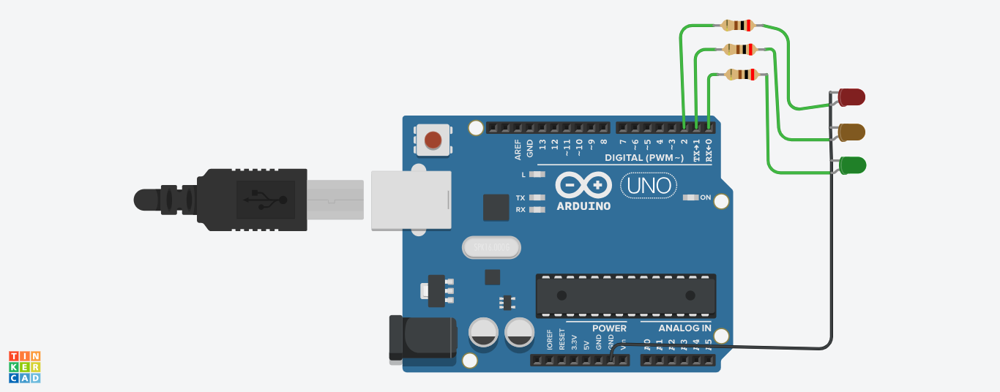

# arduino-uno-traffic-light

A timed traffic light sequence simulator designed with an Arduino Uno microcontroller to demonstrate state-machine timing, digital signal control, and LED circuit protection[cite: 5].

## How It Works

* **Sequential State Control:** The Arduino Uno executes timed code loops to switch between Red (STOP), Green (GO), and Yellow (CAUTION) states to simulate real-world traffic intersection signal patterns[cite: 5].
* **Digital Output Routing:** Digital I/O pins (Pins 13, 12, and 11) send high/low logic signals ($5\text{V} / 0\text{V}$) to drive each LED independently[cite: 5].
* **Circuit Protection:** Each LED line is wired in series with a dedicated resistor to control forward current and protect both the LEDs and Arduino pins from overcurrent damage[cite: 5].
* **Common Ground Path:** The cathodes of all three LEDs are tied together to a shared ground ($\text{GND}$) pin on the Arduino Uno[cite: 5].

## Hardware & Components Used

* **Microcontroller:** Arduino Uno R3[cite: 5]
* **Light-Emitting Diodes:** Red, Yellow, Green LEDs[cite: 5]
* **Passive Components:** 3 × Current-Limiting Resistors[cite: 5]
* **Interconnects:** Jumper Wires[cite: 5]

## Key Technical Learnings
* Programmed precise delay intervals and state logic for multi-stage processes in C++.
* Implemented basic microcontroller output hardware interfaces with individual current protection[cite: 5].
